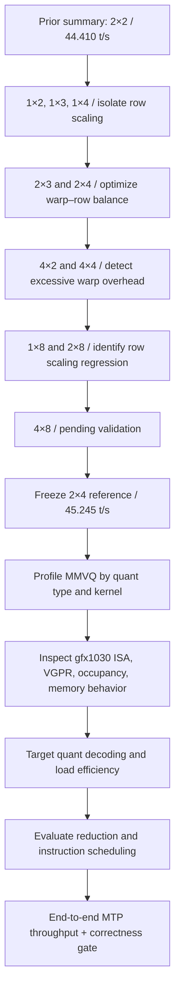

# RDNA2 MMVQ Optimization — Continuation and Targeted Roadmap

**Date:** 2026-10-10  
**Scope:** Work completed **after the previous technical summary**, whose endpoint was the **2-warps × 2-rows MMVQ experiment (44.410 tokens/s)**. Earlier infrastructure, profiling, and baseline findings are included only as dependencies or comparison points.  
**Target:** AMD Radeon RX 6800 (`gfx1030`, 16 GiB), native Ubuntu ROCm/HIP, llama.cpp `139997d`, Qwen3.8 27B IQ4_XS GGUF with embedded MTP speculative decoding (draft depth 2).  
**Measurement status:** 12 configurations benchmarked in total: three previously established references (1×1, 2×1, 2×2) and nine subsequent variants; **4×8 is configured for testing, not yet confirmed built or benchmarked**.

## 1. State at the summary boundary

| Component | Established state / reference | Relevance |
|---|---|---|
| Backend | llama.cpp ROCm/HIP for `gfx1030` | Hardware-specific kernel tuning |
| Model | `Huihui-Qwen3.8-27B-abliterated-UD-IQ4_XS.gguf` | Fixed quantized inference workload |
| Decoding | Embedded MTP, two draft tokens; observed MMVQ `ncols_dst == 3` | Three-column MMVQ specialization |
| Earlier profiling | Quantized matrix–vector multiply (`mul_mat_vec_q` / MMVQ) ≈70% of **recorded GPU kernel execution time** | Primary optimization target; **not** 70% of total wall time |
| Previous checkpoint | **2×2: 44.410 tokens/s** (two-round mean) | Continuation starting point |
| Original 1×1 reference | **42.433 tokens/s** | Performance denominator |
| Compilation | ROCm/HIP Release **`-O2`**, `gfx1030`, force MMQ, FA `f16-f16` | Preserve comparable builds; initial highly parallel/O3 builds encountered Clang failures |
| Test harness | 3,200 generated tokens, `seed=1234`, `T8_TB4_F16`, two rounds, port 8091 | Consistent A/B comparison; port 8090 left unaffected |

**Kernel intervention:** `ggml/src/ggml-cuda/mmvq.cu`, with RDNA2-only early returns in `calc_nwarps()` and `calc_rows_per_block()`, gated by `ncols_dst == 3`. No generic-target scheduling change.

```cpp
// calc_nwarps(...)
if (table_id == MMVQ_PARAMETERS_RDNA2 && ncols_dst == 3) return 2;

// calc_rows_per_block(...)
if (table_id == MMVQ_PARAMETERS_RDNA2 && ncols_dst == 3) return 4;
```

The snippet above is the **preserved winning 2×4 patch**, not necessarily the currently edited worktree source.

## 2. Experimental sweep — full reference matrix

The first three rows provide the previous baseline/checkpoint context; the subsequent rows represent follow-up configurations. Means are arithmetic averages of two independent 3,200-token runs. Improvement is relative to the 1×1 reference mean (**42.433 t/s**).

| Warps × rows | Run 1 (t/s) | Run 2 (t/s) | Mean (t/s) | Δ vs. 1×1 | Status |
|---|---:|---:|---:|---:|---|
| 1×1 | 42.177 | 42.689 | 42.433 | Reference | Previous baseline |
| 2×1 | 41.686 | 41.881 | 41.784 | −1.53% | Earlier comparison |
| 2×2 | 44.263 | 44.556 | 44.410 | +4.66% | **Prior summary endpoint** |
| **1×2** | 44.527 | 45.082 | **44.805** | **+5.59%** | Preserved; passed backend tests |
| 1×3 | 44.292 | 44.831 | 44.562 | +5.02% | Passed backend tests |
| 1×4 | 44.361 | 44.912 | 44.637 | +5.19% | Passed backend tests |
| 2×3 | 44.897 | 45.098 | 44.998 | +6.04% | Preserved; passed backend tests |
| **2×4** | **45.158** | **45.332** | **45.245** | **+6.63%** | **Fastest measured; preserved; passed** |
| 4×2 | 41.906 | 42.613 | 42.260 | −0.41% | Preserved; passed backend tests |
| 4×4 | 42.593 | 43.353 | 42.973 | +1.27% | Preserved; passed backend tests |
| 2×8 | 42.327 | 42.398 | 42.363 | −0.17% | Benchmarked; backend test **not confirmed** in provided output |
| 1×8 | 41.564 | 42.202 | 41.883 | −1.30% | Preserved; passed backend tests |
| **4×8** | — | — | — | — | **Pending: source check / compile / benchmark / test** |

### Scheduling conclusions supported by measurements

| Comparison | Observed effect | Technical interpretation / confidence |
|---|---|---|
| 1×1 → 1×2 | +5.59% | More rows helped; substantial gain at fixed warp count |
| 2×1 → 2×2 | +6.28% relative to 2×1 | Strong row-count benefit at two warps |
| 2×3 → 2×4 | +0.55% relative to 2×3 | **Small**, not resolved against run-to-run noise; output hashes matched |
| 2×4 → 2×8 | −6.37% | Strong regression with eight rows at two warps |
| 1×4 → 1×8 | −6.17% | Strong regression with eight rows at one warp |
| 2×4 → 4×4 | −5.02% | Four warps underperform two at four rows |
| 4×2 → 4×4 | +1.69% | Additional rows recover some throughput but remain below 2×4 |

**Working optimum among measured configurations:** **2×4**, **45.245 t/s**, **+6.63%** relative to 1×1. These are observed two-round measurements, **not** a claim of statistically established optimality. Additional rounds were explicitly deprioritized in favor of new kernel experiments.

### Deterministic-output grouping and MTP confounders

Same seed alone does not guarantee equal generated sequences. The following sets showed **matching per-round hashes and MTP draft acceptance counts within each set**, supporting particularly clean relative comparisons inside each group.

| Equivalence group | Compared configurations | Run 1 hash / draft | Run 2 hash / draft |
|---|---|---|---|
| 1 warp | 1×1, 1×2, 1×3, 1×4, 1×8 | `19fbb1f6c4f01168`, `1908/2582` | `fa15db84bbe93572`, `1924/2549` |
| 2 warps | 2×1, 2×2, 2×3, 2×4, 2×8 | `e7668d0b119c1705`, `1915/2565` | `257a1a4d9277b7b2`, `1921/2555` |
| 4 warps | 4×2, 4×4 | `a85a156de05ea288`, `1921/2555` | `318077964cde0f14`, `1945/2506` |

Cross-group performance differences may also reflect changed floating-point paths, output sequences, and speculative acceptance trajectories; separate within-group speed changes from those effects when drawing kernel-level conclusions.

## 3. Correctness coverage and artifacts

**Validation invocation:** `test-backend-ops test -b ROCm0 -o MUL_MAT`, with ROCm0 backend selected. **`1301/1301 tests passed`** was observed for the entries explicitly marked *Pass*. The test suite exercises matrix multiplication variants but does not prove every production shape, every specialized quantized path, or full text-output equivalence.

| Variant | Reported `1301/1301` | Binary directory / note |
|---|---|---|
| 1×2 | Pass | `~/mmvq-rdna2-1x2-bin/` |
| 1×3 | Pass | Mutable build during 1×3 stage; `~/mmvq-1x3-test.log` |
| 1×4 | Pass | Mutable build during 1×4 stage |
| 2×2 | Pass | `~/llama-rocm-mmvq-2x2/build/bin/` |
| 2×3 | Pass | `~/mmvq-rdna2-2x3-bin/` |
| **2×4** | **Pass** | **`~/mmvq-rdna2-2x4-bin/`** |
| 4×2 | Pass | `~/mmvq-rdna2-4x2-bin/` |
| 4×4 | Pass | `~/mmvq-rdna2-4x4-bin/` |
| 1×8 | Pass | `~/mmvq-rdna2-1x8-bin/` |
| 2×8 | Not recorded | `~/mmvq-rdna2-2x8-bin/` |
| 4×8 | Pending | Not yet saved/built in latest provided terminal output |

**Preserved primary artifacts**

| Path | Purpose |
|---|---|
| `~/mmvq-rdna2-2x4.patch` | Winning two-line RDNA2 2×4 source delta |
| `~/mmvq-rdna2-2x4-bin/llama-server` | Winning executable |
| `~/mmvq-rdna2-2x4-bin/libggml-hip.so` | Matching optimized GPU library; use with saved binary |
| `~/llama-rocm-mmvq-2x1/` | **Mutable** experimental Git worktree; directory name is historical, not reliable configuration metadata |
| `~/llama-rocm-mmvq-2x1/build/bin/` | Rebuilt in place for each candidate; **do not** treat as fixed 2×1 |
| `~/Downloads/bench-qwen-rocm-linux.py` | Controlled end-to-end throughput and output-hash harness |
| `~/exllamav2/bench-rocm-linux/tune-*/` | Run logs, results CSV, complete text outputs |

**Important operational detail:** When benchmarking a saved `bin/` snapshot, set `LD_LIBRARY_PATH` to that saved directory. Otherwise, the executable may load a shared HIP library from a different build and invalidate the variant attribution.

## 4. Current edge — 4×8 not yet measured

The latest source diff showed `calc_nwarps() → return 4` for RDNA2 and `ncols_dst == 3`; the terminal excerpt **ended before the row line**. The intended `calc_rows_per_block() → return 8` and the successful build still require confirmation.

### Immediate action sequence (two-round policy retained)

**A. Verify source specialization**

```bash
grep -A 1 -E 'int calc_(nwarps|rows_per_block)\(' \
  ~/llama-rocm-mmvq-2x1/ggml/src/ggml-cuda/mmvq.cu
```

Expected return values: **4 warps / 8 rows**.

**B. Incremental compile and preserve a complete `bin/` snapshot**

```bash
cmake --build ~/llama-rocm-mmvq-2x1/build --target llama-server -j 10
cp -a ~/llama-rocm-mmvq-2x1/build/bin ~/mmvq-rdna2-4x8-bin
```

**C. Benchmark exactly two rounds**

```bash
LD_LIBRARY_PATH="$HOME/mmvq-rdna2-4x8-bin" \
python3 ~/Downloads/bench-qwen-rocm-linux.py \
  --phase tune --only T8_TB4_F16 \
  --server "$HOME/mmvq-rdna2-4x8-bin/llama-server" \
  --rounds 2
```

**D. Validate matrix-multiplication backend**

```bash
LD_LIBRARY_PATH="$HOME/mmvq-rdna2-4x8-bin" \
"$HOME/mmvq-rdna2-4x8-bin/test-backend-ops" \
  test -b ROCm0 -o MUL_MAT > ~/mmvq-4x8-test.log 2>&1
tail -n 8 ~/mmvq-4x8-test.log
```

**Decision gate:** Record mean t/s, per-run hashes, MTP accepted/total, and backend correctness. Preserve 2×4 as the active performance reference unless 4×8 proves both correct and faster. No extended five-round sweep planned.

## 5. Roadmap — targeted improvements after the scheduling sweep



| Priority | Target / layer | Diagnostic or modification | Acceptance criterion | Dependencies / guardrails |
|---|---|---|---|---|
| **P0** | **Complete 4×8** | Verify 4/8 source return values; build, save, two-round benchmark, `MUL_MAT` tests | Correctness pass and recorded t/s | Do not overwrite 2×4 snapshot |
| **P0** | **Freeze reproducible winner** | Preserve `2×4.patch`, full matching `bin/`, compile flags and benchmark inputs | Reusable `2×4` executable consistently loads matching HIP library | Worktree changes are not evidence of a binary's kernel version |
| **P1** | **Quant-type hotspot breakdown** | Reprofile MMVQ execution by kernel/type: IQ4_XS, Q4_K, Q5_K, IQ3_S, IQ3_XXS | Rank the highest-cost instantiated kernels in this model | Profile **GPU kernel time** separately from wall time |
| **P1** | **Occupancy / register pressure** | Inspect gfx1030 generated ISA and code-object resource usage: VGPRs, SGPRs, spills, waves/CU, LDS | Determine whether eight-row and four-warp regressions correlate with resource pressure | Treat register-pressure explanation as a hypothesis until measured |
| **P1** | **Quantized inner-loop decode** | Inspect IQ4_XS and other dominant formats for unpack operations, integer shifts, scale reconstruction, conversion overhead | Fewer critical instructions or higher useful throughput with equal numerical test results | Change one format or code path per experiment |
| **P2** | **Memory-load efficiency** | Analyze quantized weight load coalescing, alignment, vector-load opportunity, cache behavior | Reduced bytes/instructions or measured MMVQ latency improvement | Avoid unsupported vector-width assumptions; inspect assembly |
| **P2** | **Reduction and wavefront scheduling** | Inspect dot-product accumulation, wave64 lane mapping, cross-lane reductions, dependency chains | Faster MMVQ at fixed `ncols_dst == 3` with correctness preserved | Scheduling-only sweep is already near its measured local peak |
| **P2** | **Compiler sensitivity** | Compare `-O2` baseline with tightly scoped compiler variations **only after** kernel-level profiling | Real gain with identical test conditions, no compiler crash | Avoid expensive full recompiles and previous unstable O3 / high-parallelism path |
| **P3** | **Speculative throughput integration** | Separate MTP acceptance, actual target-token generation, MMVQ microkernel time, and server overhead | End-to-end token/s improvement not explained solely by altered output trajectory | Preserve `-c 8192`, FA, F16 KV, seed, draft depth, thread/batch settings |
| **P3** | **Non-MMVQ GPU kernels** | Reprofile after MMVQ improvements; rank remaining ~30% aggregate measured GPU-kernel time | Identify next material bottleneck | Do not equate 30% GPU kernel share with 30% total runtime |

### Experiment control contract

| Variable | Required control |
|---|---|
| Build identity | Record commit `139997d`, patch diff, compiler flags and resolved shared libraries |
| Backend | ROCm0 / `gfx1030`; release HIP build with `-O2`; incremental `-j 10` |
| Model | Exact IQ4_XS GGUF path and same embedded MTP head |
| Inference | Same `T8_TB4_F16`, context 8192, F16 KV, MTP depth 2, seed 1234 and sampler settings |
| Short benchmark | **Two 3,200-token rounds**, no five-round expansion by default |
| Metrics | Per-round tokens/s, mean, output hash, accepted/total draft tokens, per-kernel profile where relevant |
| Correctness | `test-backend-ops` ROCm0 `MUL_MAT`, plus application-output sanity; record the exact result |
| Candidate promotion | No unexplained regression, no backend test failures, meaningful end-to-end speed advantage against preserved 2×4 |
| Isolation | Preserve full `bin/` snapshot and set matching `LD_LIBRARY_PATH`; change one parameter family at a time |

## 6. Current technical assessment

- **Best measured schedule:** `MMVQ_PARAMETERS_RDNA2 && ncols_dst == 3` → **2 warps, 4 rows/block**.
- **Best mean throughput:** **45.245 tokens/s** on the controlled 3,200-token × 2 workload; original 1×1 mean **42.433 tokens/s**.
- **Correctness of winner:** **1,301/1,301** `MUL_MAT` backend tests passed on ROCm0.
- **Strong negative result:** 8 rows underperform 4 rows for both one and two warps; four warps underperform two at four rows.
- **Unresolved variant:** **4×8**, source modification attempted; row verification, compilation confirmation, benchmark, and correctness still pending.
- **Next highest-value technical work:** Per-quantized-kernel profiling and gfx1030 ISA/resource analysis before modifying MMVQ quant decoding, memory loads or reductions.
- **Scope of claims:** Current gains refer to **end-to-end benchmark tokens/s** for one model/configuration. Approximate 70% profiling share refers only to measured **GPU kernel execution time**, not CPU, I/O, model load, prefill or total server wall time.
